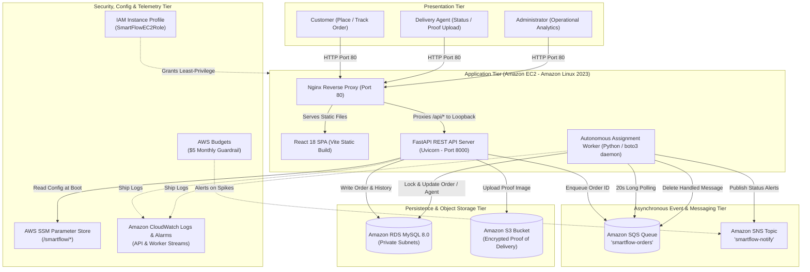
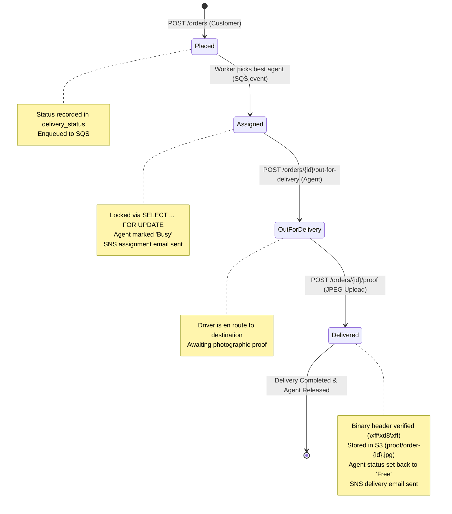
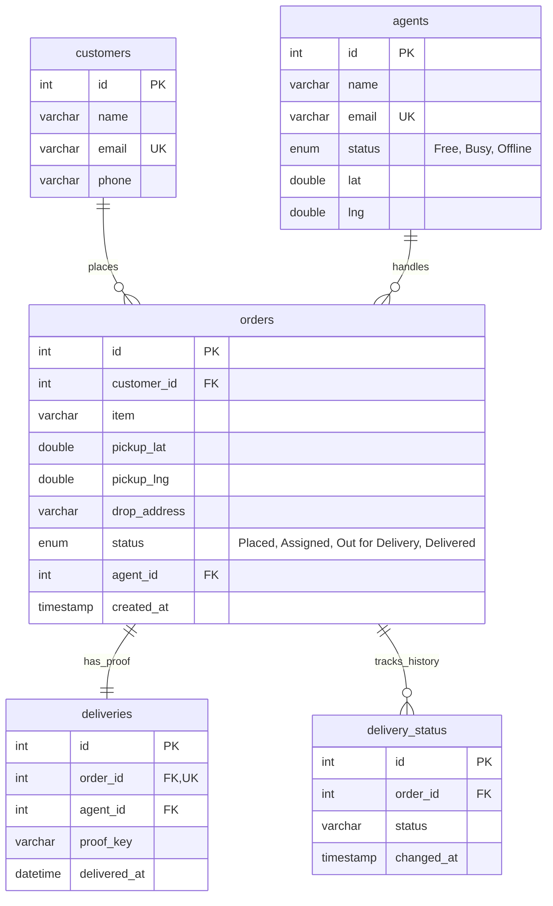

# SmartFlow: Intelligent Logistics & Delivery Management System

[](https://www.python.org/)
[](https://fastapi.tiangolo.com/)
[](https://react.dev/)
[](https://vitejs.dev/)
[](https://aws.amazon.com/)
[](https://www.mysql.com/)
[](backend/tests/)
[](#academic-metadata)

> **Cloud Computing Lab Mini-Project Report Submission — Semester V (Academic Year 2026–2027)**  
> **Department of Computer Engineering, Fr. Conceicao Rodrigues College of Engineering (CRCE), Bandra (W), Mumbai**  
> *Affiliated with the University of Mumbai*

---

## 👥 Project Team & Academic Credentials

| Role | Name | Roll No. / Identifier | Institutional Affiliation |
| :--- | :--- | :--- | :--- |
| **Team Member** | **Shravani Dandekar** | 10590 | Dept. of Computer Engineering, Fr. CRCE |
| **Team Member** | **Sera Dbritto** | 10591 | Dept. of Computer Engineering, Fr. CRCE |
| **Team Member** | **Lehel Dsilva** | 10595 | Dept. of Computer Engineering, Fr. CRCE |
| **Project Guide** | **Dr. Vijay Shelake** | Faculty / Supervisor | Dept. of Computer Engineering, Fr. CRCE |
| **Head of Department** | **Dr. Sujata Deshmukh** | HOD, Computer Dept. | Dept. of Computer Engineering, Fr. CRCE |
| **Principal** | **Dr. Sapna Prabhu** | Principal | Fr. Conceicao Rodrigues College of Engineering |
| **Submission Date** | **October 30, 2026** | Academic Session | Semester V (2026–2027) |

---

## 📑 Table of Contents

1. [Executive Overview](#-executive-overview)
2. [Sustainable Development Goals (SDG) Alignment](#-sustainable-development-goals-sdg-alignment)
3. [System Architecture & Cloud Topology](#-system-architecture--cloud-topology)
   - [High-Level Block Diagram](#high-level-block-diagram)
   - [AWS Cloud Infrastructure & Network Design](#aws-cloud-infrastructure--network-design)
   - [Order Lifecycle State Machine](#order-lifecycle-state-machine)
4. [Detailed Component Breakdown](#-detailed-component-breakdown)
5. [Core Algorithms & Technical Code Snippets](#-core-algorithms--technical-code-snippets)
   - [Haversine Spherical Great-Circle Distance](#1-haversine-spherical-great-circle-distance)
   - [Workload-Penalized Greedy Dispatch Heuristic](#2-workload-penalized-greedy-dispatch-heuristic)
   - [Idempotent SQS Consumer & Database Row-Level Locking](#3-idempotent-sqs-consumer--database-row-level-locking)
   - [Cryptographic JPEG Magic Header Validation](#4-cryptographic-jpeg-magic-header-validation)
   - [Pre-Signed S3 Proof URL Generation](#5-pre-signed-s3-proof-url-generation)
6. [Database Persistence & ER Model](#-database-persistence--er-model)
7. [RESTful API Reference](#-restful-api-reference)
8. [Dual-Mode Execution Architecture](#-dual-mode-execution-architecture)
9. [Step-by-Step Instructions to Run](#-step-by-step-instructions-to-run)
   - [Local Development Setup (PowerShell / Bash)](#option-a-local-development-setup)
   - [AWS Cloud Production Deployment Runbook](#option-b-aws-cloud-production-deployment-runbook)
10. [Automated Test Suite & Verification](#-automated-test-suite--verification)
11. [Key Engineering Challenges & Mitigations](#-key-engineering-challenges--mitigations)
12. [Repository Directory Structure](#-repository-directory-structure)
13. [Future Enhancements & Scalability Roadmap](#-future-enhancements--scalability-roadmap)

---

## 📦 Executive Overview

Last-mile logistics represents the most cost-intensive and error-vulnerable tier of the entire supply chain. In dense metropolitan regions such as Mumbai, small-and-medium enterprises (SMEs), university campuses, and local couriers often rely on ad-hoc phone calls, unmonitored chat groups, and static spreadsheets. This leads to severe operational bottlenecks:
- **Sub-optimal Dispatch**: Faraway couriers are arbitrarily assigned while nearby agents sit idle.
- **Courier Workload Imbalance**: Heavy delivery loads are piled onto single drivers without concurrency controls.
- **Lack of Delivery Traceability**: Absence of non-repudiable photographic proof-of-delivery creates customer disputes.
- **Zero Visibility & Analytics**: Dispatchers lack operational telemetry regarding delivery turnaround times and fleet throughput.

**SmartFlow** solves these challenges by providing a resilient, cloud-native automated delivery orchestration platform. It completely separates user-facing order ingestion from heavy backend dispatch computation through an asynchronous queuing pipeline. 

### Core Delivery Lifecycle Pipeline
```
[Place Order] ➔ [Transactional Ingestion] ➔ [SQS Message Broker] ➔ [Autonomous Worker] 
     ➔ [Greedy Haversine Dispatch] ➔ [Out for Delivery] ➔ [S3 Photographic Proof Upload] 
     ➔ [SNS Multi-Channel Notification] ➔ [Real-Time Operational Analytics]
```

### Key Technical Highlights
- **Decoupled Asynchronous Processing**: Order placement responds in sub-50 milliseconds by enqueuing order identifiers to an **Amazon SQS** queue, offloading geospatial optimization to an autonomous worker.
- **Zero-Credential Codebase**: Uses **AWS IAM Instance Profiles** (`SmartFlowEC2Role`) and **AWS Systems Manager (SSM) Parameter Store** (`/smartflow/*`) for encrypted secrets management. No database passwords or AWS keys are committed to Git.
- **Strict Network Isolation**: Application server sits in a public subnet while **Amazon RDS MySQL** is isolated in private subnets across two Availability Zones with zero route to the Internet Gateway.
- **Cost-Optimized FinOps Architecture**: Built without expensive NAT Gateways ($0.045/hr saved), utilizing `t3.micro` / `db.t3.micro` burstable instances, S3 lifecycle auto-expiration, and an active **AWS Budget ($5.00/month)** guardrail.
- **Dual-Mode Portability**: Run locally without an AWS account using local file-backed queues and filesystem-based S3 simulation (`SMARTFLOW_LOCAL=1`), or seamlessly run in live AWS production (`SMARTFLOW_LOCAL=0`).

---

## 🎯 Sustainable Development Goals (SDG) Alignment

SmartFlow adheres to the United Nations 2030 Agenda for Sustainable Development:

| SDG Indicator | Target Alignment | SmartFlow Architectural Feature | Quantifiable Impact |
| :--- | :--- | :--- | :--- |
| **SDG 9: Industry, Innovation & Infrastructure** *(Primary)* | **Target 9.1 & 9.5**: Build resilient, sustainable digital infrastructure for SMEs. | Custom VPC, private RDS, SQS queue decoupling, and CloudWatch telemetry alarms. | Enables local businesses to leverage enterprise-grade cloud logistics without capital data center costs. |
| **SDG 11: Sustainable Cities & Communities** | **Target 11.2 & 11.6**: Improve urban transport efficiency and lessen urban environmental impact. | Haversine distance-based nearest-agent dispatch heuristic. | Minimizes transit distance per parcel, mitigating urban traffic gridlock in dense city corridors. |
| **SDG 8: Decent Work & Economic Growth** | **Target 8.2**: Drive productivity through technological innovation and fair distribution. | Dynamic workload penalty (`+ 2 * active_orders`) in agent selection algorithm. | Prevents delivery worker fatigue and burnout by equalizing parcel allocation across the active fleet. |
| **SDG 13: Climate Action** | **Goal-level contribution**: Reduce greenhouse emissions and energy waste. | Shortest-path dispatching + lean, right-sized cloud compute with immediate teardown runbooks. | Reduces fuel burned per transit trip and minimizes idle cloud computational carbon footprint. |

---

## 🏛 System Architecture & Cloud Topology

SmartFlow follows a hardened three-tier decoupled micro-architecture deployed in the **AWS Asia Pacific (Mumbai) `ap-south-1`** region.

### High-Level Block Diagram



### AWS Cloud Infrastructure & Network Design

```mermaid
graph TB
    subgraph Internet["Public Internet"]
        Users["Users / Clients (Browser)"]
        AdminUser["DevOps Admin (SSH)"]
    end

    subgraph AWS["AWS Cloud Region: ap-south-1 (Mumbai)"]
        subgraph VPC["Custom VPC: smartflow-vpc (10.0.0.0/16)"]
            IGW["Internet Gateway"]

            subgraph PublicSubnet["Public Subnet (10.0.1.0/24) [AZ: ap-south-1a]"]
                direction TB
                subgraph SG_EC2["Security Group: smartflow-ec2-sg"]
                    EC2["EC2 t3.micro (Amazon Linux 2023)\n- Nginx (Port 80)\n- FastAPI (127.0.0.1:8000)\n- Systemd Assignment Worker\n- CloudWatch Agent"]
                end
            end

            subgraph PrivateSubnets["Private Subnets (No Internet Route)"]
                subgraph PrivSubnetA["Private Subnet A (10.0.2.0/24) [ap-south-1a]"]
                end
                subgraph PrivSubnetB["Private Subnet B (10.0.3.0/24) [ap-south-1b]"]
                end
                subgraph SG_RDS["Security Group: smartflow-rds-sg"]
                    RDS["Amazon RDS MySQL db.t3.micro\n(Single-AZ, Non-Public)"]
                end
            end
        end

        subgraph ManagedAWS["Managed AWS Regional Services (Accessible via IAM Instance Role)"]
            S3["Amazon S3 Bucket\n(Private, AES-256)"]
            SQS["Amazon SQS Queue\n(smartflow-orders)"]
            SNS["Amazon SNS Topic\n(smartflow-notify)"]
            SSM["AWS SSM Parameter Store\n(/smartflow/*)"]
            CW["Amazon CloudWatch\n(Logs, Alarms, Dashboard)"]
        end
    end

    %% Networking connections
    Users -->|HTTP: Port 80| IGW
    AdminUser -->|SSH: Port 22 (Whitelisted IP)| IGW
    IGW -->|Route 0.0.0.0/0| EC2
    EC2 -->|MySQL: Port 3306 ONLY| RDS
    PrivSubnetA -.-> RDS
    PrivSubnetB -.-> RDS

    %% AWS API Endpoint connections
    EC2 -->|HTTPS via IAM Role| S3
    EC2 -->|HTTPS via IAM Role| SQS
    EC2 -->|HTTPS via IAM Role| SNS
    EC2 -->|HTTPS via IAM Role| SSM
    EC2 -->|HTTPS via IAM Role| CW
```

> [!IMPORTANT]
> **Why No NAT Gateway?**  
> In standard AWS reference designs, private subnets access AWS endpoints via NAT Gateways. However, NAT Gateways incur a flat billing charge (~$32.40/month) independent of traffic. SmartFlow was intentionally engineered to eliminate the NAT Gateway: the RDS database *never* requires outbound internet access, and the EC2 application host resides in the public subnet, connecting directly to AWS regional service endpoints using its IAM instance role.

### Order Lifecycle State Machine

SmartFlow enforces a strict mathematical Finite State Machine (FSM). Any attempted illegal or out-of-order state transition is rejected with an `HTTP 409 Conflict`:



---

## 🔍 Detailed Component Breakdown

SmartFlow is partitioned into modular, highly cohesive services:

### 1. Presentation Tier (`frontend/`)
- Developed as a single-page reactive application using **React 18** and **Vite**.
- Contains four operational views:
  - **Place Order**: Interactive form with dynamic coordinate presets and strict input validation.
  - **Track Order**: Step-by-step audit timeline displaying status timestamps, agent details, and action triggers.
  - **Agent Dashboard**: Real-time fleet roster displaying active agent availability (`Free`, `Busy`, `Offline`) and assigned jobs.
  - **Admin Analytics**: Fleet statistics including total order distribution, average delivery turnaround time (in minutes), and agent productivity.
- Clean, responsive CSS with no bulky external UI library overhead.

### 2. Reverse Proxy & Process Supervision (`deploy/`)
- **Nginx (Port 80)**: Serves static compiled frontend assets (`/opt/smartflow/frontend/dist`) and proxies API calls matching `/api/*` to the loopback address `http://127.0.0.1:8000/`. The backend port is never exposed to the internet.
- **systemd Daemon Management**:
  - `smartflow-api.service`: Supervises the FastAPI Uvicorn ASGI server with automatic restart on failure.
  - `smartflow-worker.service`: Supervises the background Python SQS consumer worker.

### 3. RESTful API Gateway (`backend/app/main.py`)
- High-throughput asynchronous REST server built using **FastAPI** and **Pydantic**.
- Enforces strict contract schemas for payloads, latitude/longitude bounds (`[-90, 90]`, `[-180, 180]`), and email formats.
- Implements two-phase atomic transactional persistence: writes order state to RDS before pushing the order ID to SQS.

### 4. Asynchronous Queue Management (`backend/app/aws_clients.py`)
- Backed by an **Amazon SQS Standard Queue** (`smartflow-orders`).
- Configured with:
  - **Visibility Timeout**: 60 seconds (prevents duplicate worker processing during active computation).
  - **Long Polling Wait Time**: 20 seconds (eliminates empty API polling responses and minimizes AWS billing calls).
  - **Message Retention**: 1 day.

### 5. Autonomous Assignment Worker (`backend/app/worker.py`)
- Independent long-running background daemon polling SQS.
- Implements the **Idempotent Receiver Pattern**: reads messages, acquires a row-level database lock (`SELECT ... FOR UPDATE`), verifies state is `Placed`, computes the optimal agent, transitions state to `Assigned`, and only deletes the SQS message upon successful transaction commit.

### 6. Relational Database Tier (`backend/schema.sql`, `backend/app/db.py`)
- Hosted on **Amazon RDS MySQL 8.0** (`db.t3.micro`) inside private subnets.
- Employs indexed foreign key relationships across 5 core entities, preventing orphaned records and ensuring ACID compliance.

### 7. Digital Proof Storage & Pre-Signed Subsystem (`backend/app/aws_clients.py`)
- Leverages a private **Amazon S3** bucket (`smartflow-proof-*`) with **S3 Block Public Access** enabled and **AES-256 server-side encryption**.
- Delivery agents upload photographic JPEG proofs upon completion.
- Proofs are securely viewed by customers and dispatchers via **time-limited Pre-Signed URLs** (valid for 300 seconds), keeping the underlying S3 bucket 100% private.

### 8. Multi-Channel Notification Engine (`backend/app/aws_clients.py`)
- Backed by **Amazon SNS** (`smartflow-notify`).
- Publishes automated email alerts when:
  1. An agent is successfully assigned to a new order.
  2. An order is marked as `Delivered` with photographic proof.

### 9. Secret & Parameter Management (`backend/app/config.py`)
- Eliminates local credential leakage using **AWS Systems Manager (SSM) Parameter Store**.
- In cloud mode (`SMARTFLOW_LOCAL=0`), reads `/smartflow/db_host`, `/smartflow/db_user`, `/smartflow/db_password` (SecureString), `/smartflow/db_name`, `/smartflow/sqs_url`, `/smartflow/sns_arn`, and `/smartflow/bucket` dynamically at runtime.

### 10. Operational Telemetry & Alarms (`deploy/cloudwatch-agent.json`)
- **Amazon CloudWatch Agent** collects and streams `/var/log/smartflow-api.log` and `/var/log/smartflow-worker.log`.
- Configured CloudWatch Alarms:
  - **EC2 CPU Utilization Alarm**: Alerts if CPU exceeds 70% for 2 consecutive periods.
  - **SQS Backlog Depth Alarm**: Alerts if `ApproximateNumberOfMessagesVisible > 0` for 5 minutes (indicating worker downtime or database deadlock).

---

## ⚡ Core Algorithms & Technical Code Snippets

### 1. Haversine Spherical Great-Circle Distance
Computes the shortest surface distance between two latitude/longitude points on Earth ($R = 6371\text{ km}$), independent of external third-party mapping APIs:

$$\Delta\phi = \phi_2 - \phi_1, \quad \Delta\lambda = \lambda_2 - \lambda_1$$
$$a = \sin^2\left(\frac{\Delta\phi}{2}\right) + \cos(\phi_1)\cos(\phi_2)\sin^2\left(\frac{\Delta\lambda}{2}\right)$$
$$d = 2R \arcsin(\sqrt{a})$$

```python
# Reference: backend/app/assignment.py
from math import asin, cos, radians, sin, sqrt

def haversine_km(lat1: float, lng1: float, lat2: float, lng2: float) -> float:
    if not all(-90 <= lat <= 90 for lat in (lat1, lat2)):
        raise ValueError("latitude must be between -90 and 90")
    if not all(-180 <= lng <= 180 for lng in (lng1, lng2)):
        raise ValueError("longitude must be between -180 and 180")
    
    d_lat = radians(lat2 - lat1)
    d_lng = radians(lng2 - lng1)
    value = sin(d_lat / 2) ** 2 + cos(radians(lat1)) * cos(radians(lat2)) * sin(d_lng / 2) ** 2
    return 6371.0 * 2 * asin(sqrt(value))
```

### 2. Workload-Penalized Greedy Dispatch Heuristic
Pure physical distance dispatch often starves couriers or overloads agents in dense commercial hubs. SmartFlow calculates a compound suitability score:

$$\text{Score}(\text{Agent}) = \text{Distance}_{\text{km}}(\text{Agent}, \text{Pickup}) + 2 \times \text{ActiveOrders}(\text{Agent})$$

*The penalty factor of $2$ models 1 active delivery as equivalent to 2 additional kilometers of travel distance.*

```python
# Reference: backend/app/assignment.py
def choose_best_agent(
    agents: Iterable[Mapping[str, object]],
    pickup_lat: float,
    pickup_lng: float,
) -> Mapping[str, object] | None:
    candidates: list[tuple[float, Mapping[str, object]]] = []
    for agent in agents:
        if agent.get("status") != "Free":
            continue
        try:
            lat = float(agent["lat"])
            lng = float(agent["lng"])
            active_orders = int(agent.get("active_order_count", 0))
            # Compound score: physical distance + penalty for active workload
            score = haversine_km(pickup_lat, pickup_lng, lat, lng) + 2 * active_orders
        except (KeyError, TypeError, ValueError):
            continue
        candidates.append((score, agent))
    
    return min(candidates, key=lambda item: item[0])[1] if candidates else None
```

### 3. Idempotent SQS Consumer & Database Row-Level Locking
Because Amazon SQS Standard queues guarantee **at-least-once delivery**, workers may receive the same message twice under network retries. SmartFlow uses pessimistic locking (`SELECT ... FOR UPDATE`) within a database transaction:

```python
# Reference: backend/app/worker.py
def process_message(message: dict[str, str]) -> bool:
    payload = json.loads(message["Body"])
    order_id = int(payload["order_id"])
    
    with db.connection() as conn:
        with conn.cursor() as cursor:
            # 1. Acquire pessimistic row lock
            cursor.execute("SELECT * FROM orders WHERE id=%s FOR UPDATE", (order_id,))
            order = cursor.fetchone()
            
            # Idempotency check: if already assigned/processed, discard duplicate
            if not order or order["status"] != "Placed":
                conn.rollback()
                return True
            
            # 2. Query free agents with their current active order counts
            cursor.execute(
                """SELECT a.*, COUNT(CASE WHEN o.status IN ('Assigned','Out for Delivery')
                    THEN o.id END) AS active_order_count
                    FROM agents a LEFT JOIN orders o ON o.agent_id=a.id
                    GROUP BY a.id"""
            )
            agent = choose_best_agent(cursor.fetchall(), float(order["pickup_lat"]), float(order["pickup_lng"]))
            if not agent:
                conn.rollback()
                return False  # Queue visibility timeout will retry automatically
            
            # 3. Transition order and agent state atomically
            cursor.execute("UPDATE orders SET agent_id=%s, status='Assigned' WHERE id=%s", (agent["id"], order_id))
            cursor.execute("UPDATE agents SET status='Busy' WHERE id=%s", (agent["id"],))
            cursor.execute("INSERT INTO delivery_status (order_id, status) VALUES (%s, 'Assigned')", (order_id,))
        conn.commit()
    
    # 4. Notify via SNS only after successful database commit
    aws_clients.notify("Order assigned", f"Order {order_id} assigned to agent {agent['name']}.")
    return True
```

### 4. Cryptographic JPEG Magic Header Validation
To prevent attackers from uploading malicious executables disguised as image proofs, SmartFlow validates the binary magic byte signature (`FF D8 FF`) directly from the binary stream:

```python
# Reference: backend/app/main.py
def _is_jpeg_upload(file: UploadFile) -> bool:
    file.file.seek(0)
    signature = file.file.read(3)
    file.file.seek(0)
    # JPEG files strictly begin with the 3-byte sequence 0xFF 0xD8 0xFF
    return signature == b"\xff\xd8\xff"
```

### 5. Pre-Signed S3 Proof URL Generation
Enables secure client-side image viewing without exposing public bucket access:

```python
# Reference: backend/app/aws_clients.py
def presign_proof(key: str) -> str:
    settings = get_settings()
    if settings.smartflow_local:
        return f"/local-proof/{quote(key)}"
    
    # Generate time-limited secure link (expires in 300 seconds)
    return _client("s3").generate_presigned_url(
        "get_object",
        Params={"Bucket": settings.s3_bucket, "Key": key},
        ExpiresIn=300
    )
```

---

## 🗄 Database Persistence & ER Model

SmartFlow utilizes a relational schema in MySQL configured with strict foreign keys and cascading indexes.



### Seed Agent Geographic Distribution (Mumbai Metropolitan Area)
The initial schema loader (`backend/scripts/load_schema.py`) provisions four simulated agents stationed strategically across the Mumbai urban territory:

| Agent Name | Initial Status | Latitude | Longitude | Operational Hub / Region |
| :--- | :--- | :--- | :--- | :--- |
| **Ravi** | `Free` | `19.2183` | `72.9781` | Thane Hub |
| **Priya** | `Free` | `19.0760` | `72.8777` | Central Mumbai / Bandra-Kurla Complex (BKC) |
| **Imran** | `Free` | `19.1197` | `72.8464` | Andheri / Western Suburbs |
| **Sneha** | `Free` | `19.0330` | `73.0297` | Navi Mumbai / Vashi Hub |

---

## 🌐 RESTful API Reference

The backend exposes an OpenAPI 3.0 specification accessible via interactive Swagger UI at `http://localhost:8000/docs`:

| Method | Endpoint | Request Body / Parameters | Success Status | Description |
| :--- | :--- | :--- | :--- | :--- |
| `GET` | `/health` | *None* | `200 OK` | Liveness health check used by load balancers and deployment verification. |
| `POST` | `/orders` | `{ name, email, item, pickup_lat, pickup_lng, drop_address }` | `201 Created` | Creates customer record, inserts order as `Placed`, and enqueues to SQS. |
| `GET` | `/orders/{id}` | Path: `id` (int) | `200 OK` | Returns full order metadata, assigned agent details, and complete chronological audit history. |
| `GET` | `/agents` | *None* | `200 OK` | Retrieves list of all registered couriers and their availability status. |
| `POST` | `/agents/{id}/status` | `{ status: "Free" \| "Busy" \| "Offline" }` | `200 OK` | Manually updates an agent's fleet availability. |
| `GET` | `/agents/{id}/orders` | Path: `id` (int) | `200 OK` | Retrieves active parcels (`Assigned` or `Out for Delivery`) for a specific agent. |
| `POST` | `/orders/{id}/out-for-delivery`| Path: `id` (int) | `200 OK` | Advances assigned order into the `Out for Delivery` transit state. |
| `POST` | `/orders/{id}/proof` | Multipart Form: `file` (JPEG image) | `200 OK` | Validates image header, uploads to S3, marks order `Delivered`, frees agent, and triggers SNS. |
| `GET` | `/orders/{id}/proof-url` | Path: `id` (int) | `200 OK` | Generates a secure, 300-second pre-signed S3 URL to view delivery proof. |
| `GET` | `/analytics` | *None* | `200 OK` | Aggregates order count by status, per-agent volume, and average delivery turnaround in minutes. |
| `GET` | `/local-proof/{key}` | Path: `key` (string) | `200 OK` | *(Local mode only)* Serves local proof images directly from `local_s3/`. |

---

## 🔄 Dual-Mode Execution Architecture

SmartFlow features a seamless **Dual-Mode abstraction layer** controlled by the `SMARTFLOW_LOCAL` environment flag:

```
                            ┌───────────────────────────────┐
                            │    SmartFlow Application      │
                            └───────────────┬───────────────┘
                                            │
                     ┌──────────────────────┴──────────────────────┐
                     ▼                                             ▼
          [SMARTFLOW_LOCAL = 1]                         [SMARTFLOW_LOCAL = 0]
             Local Dev Mode                                Cloud AWS Mode
   ──────────────────────────────────            ──────────────────────────────────
   • SQS ➔ local_queue.txt (file append)         • SQS ➔ AWS SQS 'smartflow-orders'
   • S3  ➔ local_s3/proofs/ directory            • S3  ➔ AWS S3 Encrypted Bucket
   • SNS ➔ stdout console logging                • SNS ➔ AWS SNS Email Topic
   • Config ➔ .env file                          • Config ➔ AWS SSM Parameter Store
   • DB ➔ Local MySQL instance                   • DB ➔ Private Amazon RDS MySQL
```

---

## 🚀 Step-by-Step Instructions to Run

### Option A: Local Development Setup

Run the entire application on your developer workstation with zero AWS credentials or cloud costs.

#### Prerequisites
- **Python 3.11+** installed
- **Node.js 18+** & **npm** installed
- **MySQL 8.0+** running locally

#### 1. Clone & Configure Environment
```bash
git clone https://github.com/your-username/SmartFlow-CCL.git
cd SmartFlow-CCL

# Copy local configuration
cp .env.example .env
```
*(On Windows PowerShell, use: `Copy-Item .env.example .env`)*

Verify `.env` contains local settings:
```ini
SMARTFLOW_LOCAL=1
AWS_REGION=ap-south-1
DB_HOST=127.0.0.1
DB_PORT=3306
DB_USER=smartflow
DB_PASSWORD=your_local_password
DB_NAME=smartflow
```

#### 2. Backend Environment & Dependencies
```powershell
cd backend
python -m venv .venv

# Activate virtual environment:
# Windows PowerShell:
.\.venv\Scripts\Activate.ps1
# Linux / macOS:
# source .venv/bin/activate

pip install -r requirements.txt
```

#### 3. Initialize Database Schema & Seed Data
Ensure MySQL is running and your database/user exists:
```sql
CREATE DATABASE smartflow;
CREATE USER 'smartflow'@'localhost' IDENTIFIED BY 'your_local_password';
GRANT ALL PRIVILEGES ON smartflow.* TO 'smartflow'@'localhost';
FLUSH PRIVILEGES;
```
Then load the schema and seed couriers:
```powershell
python -m scripts.load_schema
```

#### 4. Launch the FastAPI API Server (Terminal 1)
```powershell
cd backend
.\.venv\Scripts\Activate.ps1
uvicorn app.main:app --reload --port 8000
```
*API will be live at `http://localhost:8000`. Test health at `http://localhost:8000/health`.*

#### 5. Launch the Assignment Worker (Terminal 2)
```powershell
cd backend
.\.venv\Scripts\Activate.ps1
python -m app.worker
```
*The worker runs in the background, listening for orders written to `backend/local_queue.txt`.*

#### 6. Launch the React Frontend (Terminal 3)
```powershell
cd frontend
npm install
npm run dev
```
*Frontend will launch at `http://localhost:5173`. Open in your browser to place and track orders.*

---

### Option B: AWS Cloud Production Deployment Runbook

Follow this runbook to deploy SmartFlow to **AWS `ap-south-1` (Mumbai)**.

#### Step 1: Create Custom VPC & Subnets
1. **VPC**: Create `smartflow-vpc` with CIDR `10.0.0.0/16`.
2. **Subnets**:
   - `smartflow-public-subnet` (`10.0.1.0/24`) in `ap-south-1a`.
   - `smartflow-private-subnet-a` (`10.0.2.0/24`) in `ap-south-1a`.
   - `smartflow-private-subnet-b` (`10.0.3.0/24`) in `ap-south-1b`.
3. **Internet Gateway**: Create `smartflow-igw`, attach to `smartflow-vpc`.
4. **Route Table**: Create public route table, associate with `smartflow-public-subnet`, add route `0.0.0.0/0 -> smartflow-igw`.

#### Step 2: Configure Security Groups
- `smartflow-ec2-sg`:
  - Inbound: HTTP (80) from `0.0.0.0/0`.
  - Inbound: SSH (22) from your IP only (`x.x.x.x/32`).
- `smartflow-rds-sg`:
  - Inbound: MySQL TCP (3306) restricted exclusively to source security group `smartflow-ec2-sg`.

#### Step 3: Provision AWS Managed Resources
- **RDS MySQL**: Create `db.t3.micro` Single-AZ instance in a DB Subnet Group containing the two private subnets. Disable public accessibility.
- **S3 Bucket**: Create private bucket `smartflow-proof-<account_id>`, enable AES-256 encryption, enable Block Public Access, and add a 30-day lifecycle expiration rule.
- **SQS Queue**: Create Standard queue `smartflow-orders` with 60s visibility timeout and 20s receive wait time.
- **SNS Topic**: Create Standard topic `smartflow-notify`, add email subscription, and confirm subscription via verification link.

#### Step 4: Populate SSM Parameter Store
Execute via AWS CLI or AWS Console:
```bash
aws ssm put-parameter --name "/smartflow/db_host" --value "<rds-endpoint>" --type "String"
aws ssm put-parameter --name "/smartflow/db_user" --value "smartflow" --type "String"
aws ssm put-parameter --name "/smartflow/db_password" --value "<secure-password>" --type "SecureString"
aws ssm put-parameter --name "/smartflow/db_name" --value "smartflow" --type "String"
aws ssm put-parameter --name "/smartflow/sqs_url" --value "<sqs-queue-url>" --type "String"
aws ssm put-parameter --name "/smartflow/sns_arn" --value "<sns-topic-arn>" --type "String"
aws ssm put-parameter --name "/smartflow/bucket" --value "<s3-bucket-name>" --type "String"
```

#### Step 5: Attach IAM Role & Bootstrap EC2 Instance
1. Create IAM Role `SmartFlowEC2Role` for EC2 with permissions from `deploy/iam-policy.json` and AWS managed policy `CloudWatchAgentServerPolicy`.
2. Launch `t3.micro` instance running **Amazon Linux 2023** in `smartflow-public-subnet` with `smartflow-ec2-sg` and attach `SmartFlowEC2Role`.
3. SSH into instance and run the bootstrap script:
```bash
chmod +x deploy/bootstrap.sh
sudo ./deploy/bootstrap.sh
```

#### Step 6: Deploy Code & Enable systemd Services
```bash
# Clone repository
git clone <repo-url> /opt/smartflow
cd /opt/smartflow

# Build React Frontend
cd /opt/smartflow/frontend
npm install
npm run build

# Install Python backend dependencies
cd /opt/smartflow/backend
python3.11 -m venv .venv
source .venv/bin/activate
pip install -r requirements.txt

# Run database schema loader
python -m scripts.load_schema

# Configure Nginx & systemd
sudo cp /opt/smartflow/deploy/nginx.conf /etc/nginx/conf.d/smartflow.conf
sudo nginx -t && sudo systemctl reload nginx

sudo cp /opt/smartflow/deploy/smartflow-api.service /etc/systemd/system/
sudo cp /opt/smartflow/deploy/smartflow-worker.service /etc/systemd/system/
sudo systemctl daemon-reload
sudo systemctl enable --now smartflow-api smartflow-worker

# Start CloudWatch telemetry agent
sudo /opt/aws/amazon-cloudwatch-agent/bin/amazon-cloudwatch-agent-ctl \
  -a fetch-config -m ec2 -s -c file:/opt/smartflow/deploy/cloudwatch-agent.json
```

---

## 🧪 Automated Test Suite & Verification

The repository contains an automated unit and contract test suite written in **pytest**. The test suite tests the system without requiring live AWS credentials or an active database.

### Running Tests
```bash
cd backend
pytest -q
```

### Test Coverage Summary (22 Passing Tests)
```
......................                                                   [100%]
22 passed in 1.86s
```

| Test Module | Test Focus & Verification Assertions |
| :--- | :--- |
| `tests/test_health.py` | Validates API liveness check endpoint returns `{"ok": True}`. |
| `tests/test_assignment.py` | Validates Haversine accuracy, bounds validation (`[-90,90]`, `[-180,180]`), and workload penalty dispatch scoring. |
| `tests/test_orders.py` | Enforces FSM legal transitions, rejection of illegal jumps (e.g. `Placed` to `Delivered`), and JPEG magic byte checks. |
| `tests/test_aws_clients.py` | Verifies local vs. cloud fallback modes for SQS, S3, and SNS wrappers. |
| `tests/test_config.py` | Asserts that SSM Parameter Store values strictly take precedence over environment defaults in AWS mode. |

---

## 🛠 Key Engineering Challenges & Mitigations

During end-to-end development and AWS cloud provisioning, several technical challenges arose. They were systematically resolved and documented:

| Challenge Encountered | Root Cause Analysis | Engineering Resolution & Mitigation |
| :--- | :--- | :--- |
| **AWS Security Group Name Rejection** | AWS prohibits security group names starting with the reserved prefix `sg-`. | Renamed security groups to semantic identifiers: `smartflow-ec2-sg` and `smartflow-rds-sg`. |
| **EC2 Browser Console SSH Failure** | Port 22 was strictly locked down to the developer's public IP address. | Connected securely via local terminal SSH using keypair; maintained least-privilege rather than opening `0.0.0.0/0`. |
| **Missing Git on Amazon Linux 2023** | Minimal base AMI excludes developer tooling by default. | Added `git` explicitly to `dnf install` package manifest in `deploy/bootstrap.sh`. |
| **GitHub Password Authentication Rejection** | GitHub discontinued password authentication over HTTPS in 2021. | Used fine-grained GitHub Personal Access Tokens (PAT) for repo cloning. |
| **Initial 503 on Order Creation in AWS** | Application defaulted to `127.0.0.1` because default settings overrode Parameter Store values. | Patched `backend/app/config.py` ensuring Parameter Store parameters dynamically overwrite all defaults in production. |
| **Frontend Form Displayed `[object Object]`** | FastAPI validation errors return a list of error dictionaries, which React coerced improperly. | Updated `frontend/src/api.js` error parser to format nested validation objects into clean human-readable text. |
| **Reserved Domain Email Rejection** | Pydantic's `EmailStr` validator rejects non-routable domains like `.test`. | Utilized standard RFC-compliant test email addresses in all automated fixtures and manual demonstrations. |
| **Direct SNS Customer Notifications** | Amazon SNS email requires recipient manual subscription confirmation. | Subscribed primary operator emails for lab demonstration; documented **Amazon SES** as production upgrade. |

---

## 📂 Repository Directory Structure

```
SmartFlow-CCL/
├── .env.example                     # Environment template for local and cloud execution
├── README.md                        # Master project documentation
├── Report_Index.md                  # Comprehensive academic report index and blueprint
│
├── backend/                         # FastAPI backend service
│   ├── requirements.txt             # Python dependencies (FastAPI, PyMySQL, boto3, pytest)
│   ├── schema.sql                   # MySQL relational schema definition and seed couriers
│   ├── local_queue.txt              # Local mode simulated SQS message queue
│   ├── local_s3/                    # Local mode simulated S3 proof storage directory
│   ├── app/                         # Application source code
│   │   ├── __init__.py
│   │   ├── main.py                  # FastAPI REST endpoints, state machine, and error handlers
│   │   ├── assignment.py            # Haversine distance and greedy scoring algorithms
│   │   ├── worker.py                # Autonomous SQS background consumer daemon
│   │   ├── aws_clients.py           # SQS, S3, SNS wrappers with local fallback
│   │   ├── config.py                # Dynamic configuration loader (SSM Parameter Store / .env)
│   │   └── db.py                    # MySQL connection pooling and transaction manager
│   ├── scripts/
│   │   └── load_schema.py           # Automated schema runner and database seeder
│   └── tests/                       # Automated Pytest suite (22 unit & contract tests)
│       ├── test_health.py
│       ├── test_assignment.py
│       ├── test_orders.py
│       ├── test_aws_clients.py
│       └── test_config.py
│
├── frontend/                        # React 18 single-page application
│   ├── package.json                 # Node dependencies (React 18, Vite)
│   ├── vite.config.js               # Vite build configuration with /api proxy
│   ├── public/                      # Static branding assets
│   └── src/
│       ├── main.jsx                 # React root entry point
│       ├── App.jsx                  # Main interface (Place, Track, Dashboard, Analytics)
│       ├── api.js                   # API client and error formatting utility
│       └── index.css                # Pure responsive CSS stylesheets
│
├── deploy/                          # Cloud deployment configurations
│   ├── bootstrap.sh                 # Amazon Linux 2023 host initialization script
│   ├── nginx.conf                   # Nginx reverse proxy configuration
│   ├── smartflow-api.service        # systemd unit for FastAPI Uvicorn server
│   ├── smartflow-worker.service     # systemd unit for SQS assignment worker
│   ├── cloudwatch-agent.json        # CloudWatch Agent log aggregation configuration
│   └── iam-policy.json              # Least-privilege IAM policy template
│
├── docs/                            # In-depth architectural & testing documentation
│   ├── architecture.md              # Cloud architecture and decoupling design notes
│   ├── cost-and-teardown.md         # FinOps guide and step-by-step AWS teardown runbook
│   └── testing.md                   # Complete test execution procedures
│
└── infrastructure/                  # Infrastructure blueprint documentation
    └── README.md                    # AWS manual provisioning and runbook guide
```

---

## 🔮 Future Enhancements & Scalability Roadmap

For transition from an academic prototype to an enterprise-grade multi-tenant production system:

1. **High Availability & Autoscaling**:
   - Provision an **Application Load Balancer (ALB)** spanning multiple public subnets.
   - Place EC2 instances behind an **Auto Scaling Group (ASG)** scaling based on SQS queue depth (`ApproximateNumberOfMessagesVisible`).
   - Migrate RDS to **Multi-AZ** deployment with automated daily snapshots and read replicas.
2. **Zero-Trust Identity & Access Management**:
   - Integrate **Amazon Cognito User Pools** for customer, agent, and administrator OAuth2 / JWT authentication and Role-Based Access Control (RBAC).
   - Protect administration and analytics views behind signed JWT tokens.
3. **Enterprise Messaging Reliability**:
   - Attach a **Dead Letter Queue (DLQ)** to `smartflow-orders` with CloudWatch alarms to isolate unprocessable poison-pill messages after 3 failed retries.
   - Evaluate **Amazon SQS FIFO** for applications requiring strict first-in-first-out sequencing.
4. **Production Customer Notifications**:
   - Implement **Amazon SES (Simple Email Service)** with a custom verified domain to dispatch transactional notifications directly to arbitrary customer email addresses without manual subscription confirmations.
   - Implement **Amazon SNS SMS / Mobile Push Notifications** to ping mobile couriers in real-time.
5. **Real-Time Dynamic Telematics**:
   - Replace static agent coordinates with continuous **WebSocket** updates from driver GPS units.
   - Replace straight-line Haversine calculations with road network travel times using OSRM (Open Source Routing Machine) or Google Maps Distance Matrix API.
6. **Infrastructure as Code (IaC)**:
   - Package all AWS resources into declarative **Terraform** modules or **AWS CloudFormation** templates to enable zero-click provisioning and teardown.

---

## 📜 Academic Acknowledgments

We express our sincere gratitude to:
- **Dr. Vijay Shelake**, our project guide, for his invaluable technical mentorship, constructive suggestions, and guidance throughout the cloud architecture design and deployment phases.
- **Dr. Sujata Deshmukh**, Head of the Computer Engineering Department, and **Dr. Sapna Prabhu**, Principal of Fr. Conceicao Rodrigues College of Engineering, for providing the necessary computational lab infrastructure, cloud resources, and academic environment.

---
*SmartFlow — Built for Cloud Computing Lab (Semester V) • Fr. Conceicao Rodrigues College of Engineering, Mumbai • 2026–2027*
